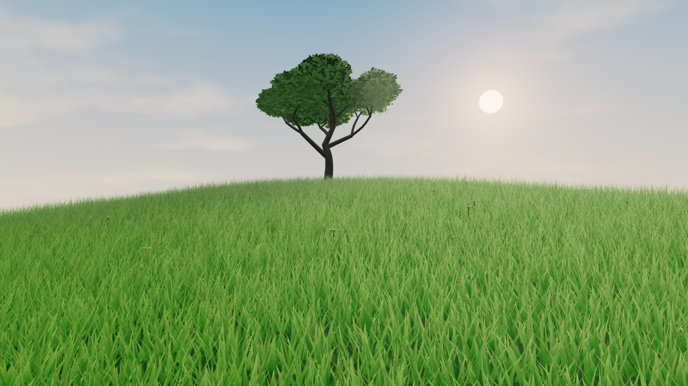
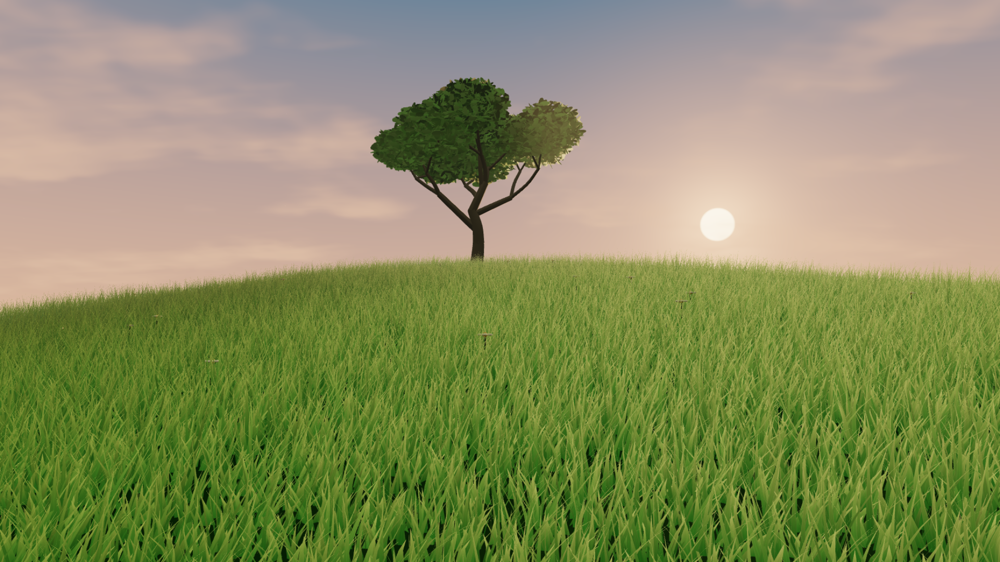
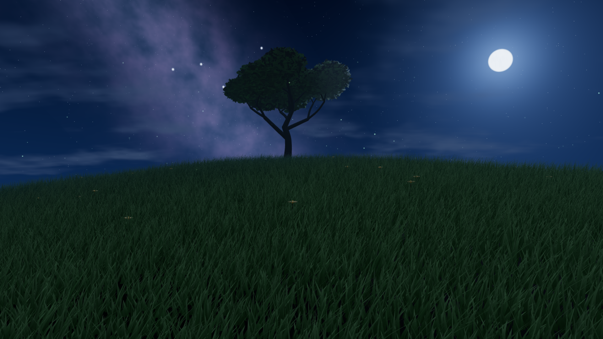

<div align="center">

# Living Meadow

### A meadow that moves with you.

A real-time, interactive 3D meadow wallpaper for Windows, built with Three.js, WebGL 2 and custom GPU shaders. Brush the grass with your cursor, watch birds lift from the tree, and let the landscape shift from golden hour to a star-lit night.

[Download for Lively](https://github.com/Gigantisimo/living-meadow/raw/refs/heads/main/Living-Meadow-Lively.zip) · [Source code ZIP](https://github.com/Gigantisimo/living-meadow/raw/refs/heads/main/Living-Meadow-Source.zip)

</div>

## A little room to breathe

Living Meadow turns your desktop into a quiet, living landscape. Thousands of individually animated grass blades sway in an uneven breeze. Move the pointer through the meadow and nearby blades bend, part, then gently spring back. At night, disturbed fireflies rise from the grass. Hover over the lone tree and a small flock takes flight.

There is no pre-rendered background: the hill, grass, tree, sky, lighting and particles are rendered as a real-time 3D scene.

## Three moods

| Morning | Golden hour | Night |
| --- | --- | --- |
|  |  |  |
| Soft dawn light and a fresh green hillside. | Warm sunset light, long shadows and glowing grass tips. | Moonlight, stars, a Milky Way, fireflies and cool green grass. |

Transitions blend over 2.7 seconds. Auto mode follows your local time.

## Made to feel alive

- **Interactive GPU grass:** 145,000 blades in High mode, with curved, tapered geometry, layered ground cover, wind and a spring-like pointer response.
- **A changing meadow:** Morning, Golden, Night and Auto, with smoothly blended sky, light and plant colours.
- **Small moments of life:** Birds scatter from the tree; fireflies drift above the hill and rise when the grass is brushed at night.
- **A sky worth looking up at:** Procedural clouds, stars, moonlight and a soft Milky Way band.
- **Performance controls:** Four grass density levels, three graphics presets, a 30/60 FPS cap, adaptive distant detail and a render-pixel budget.
- **Offline by design:** The wallpaper runs locally without a CDN, cloud service or network connection.

## Install on Windows

1. Install [Lively Wallpaper](https://www.rocksdanister.com/lively/).
2. Download **Living-Meadow-Lively.zip** above and drag it into Lively's library.
3. Select Living Meadow and apply it to your desktop.
4. Open **Customise** in Lively to adjust time of day, wind, grass density, graphics quality and other settings.
5. To brush the meadow, enable mouse interaction in Lively's wallpaper interaction settings.

For an older Lively version that cannot import the ZIP, extract it to a permanent folder and add its `index.html` as a web wallpaper.

The desktop interaction depends on Lively forwarding pointer events. The wallpaper package has been tested in an offline Chromium browser; a Windows desktop import and mouse forwarding through Lively still need an on-device check. Hardware-accelerated WebGL 2 and `EXT_color_buffer_float` are required.

## Run from source

Requires Node.js 20 or later.

```powershell
npm install
npm run dev
npm test
npm run build
npm run package
```

The production build is a self-contained `dist/index.html` that works offline. `npm run package` creates Lively and source archives in `release/`.

## Performance notes

Measured on an AMD Radeon integrated GPU using Chromium / Direct3D 11: High at 1080p averaged about 32 FPS; Low at a 30 FPS cap held 30 FPS. High at 1440p and ultrawide resolution ran around 11–12 FPS on this machine. Results vary by GPU, driver, browser and desktop load. Start with **Low graphics / Low grass / 30 FPS** on an integrated GPU; 60 FPS has not been verified on a discrete card.

The framebuffer scales down under load while keeping the window composition intact. Grass is drawn in four instanced groups; distant blades fade smoothly as the adaptive detail level changes.

## Project map

```text
src/
  scene/          Terrain, grass, tree, sky, lighting and particles
  shaders/        GLSL for grass, sky and the interactive spring field
  systems/        Time of day, wind, settings and quality control
  integrations/   Lively Wallpaper properties and pause events
public/           Lively metadata and library thumbnail
scripts/          Offline bundling and packaging
 tests/           Unit and browser verification
```

The repository includes the ready-to-import Lively ZIP and the complete source ZIP alongside the browsable source tree.

## License

Living Meadow is released under the [MIT License](LICENSE). Three.js is also MIT licensed; see the bundled third-party notices in the Lively package.
